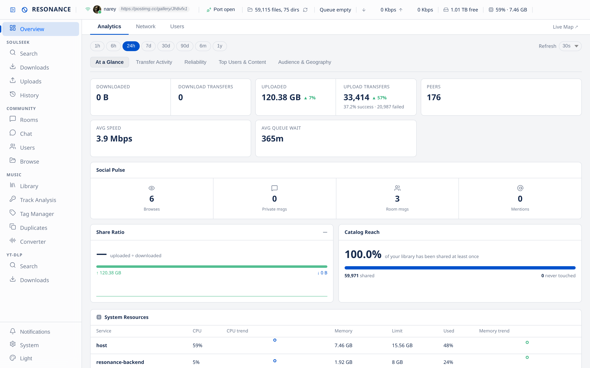
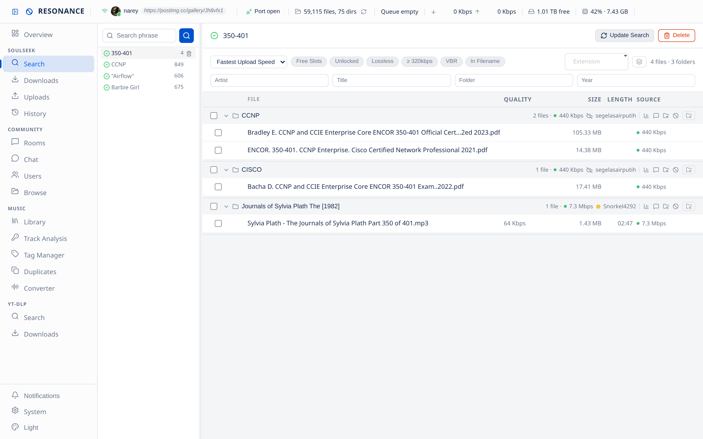
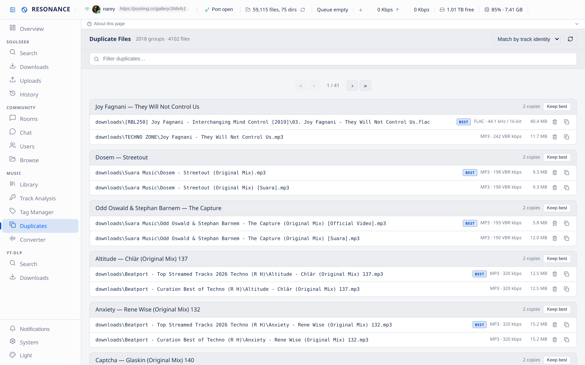

<div align="center">
  
  <h1>Resonance</h1>
  <p><strong>A modern, self-hosted Soulseek client built around your music library.</strong></p>
  <p>Search, share, download, stream, analyse, tag, mix, and manage your collection from the web or mobile.</p>
  <p>
    <a href="#-what-resonance-does">Features</a> ·
    <a href="#-screenshots">Screenshots</a> ·
    <a href="#-quick-start">Quick start</a> ·
    <a href="#-architecture">Architecture</a> ·
    <a href="#-development">Development</a> ·
    <a href="#-license">License</a>
  </p>
  <p>
    
    
    
    
    <a href="LICENSE"></a>
  </p>
</div>

---

Resonance turns Soulseek into a complete, self-hosted music workspace. Alongside fast search and transfer management, it includes a persistent music library, in-browser playback, audio analysis, metadata enrichment, public mixtapes, real-time chat, multi-user permissions, and a companion mobile app. New installations use SQLite; PostgreSQL remains supported.

> [!IMPORTANT]
> Resonance is a modified version of [slskd](https://github.com/slskd/slskd). It is not maintained by, endorsed by, or affiliated with the slskd project or its author(s).

## ✨ What Resonance does

### Find and transfer

- Search Soulseek with inline filters for bitrate, size, duration, folder contents, encoding, and excluded terms.
- Browse a user's complete share tree and download individual files or entire folders.
- Manage live uploads and downloads with priorities, queue strategies, retry policies, speed limits, quotas, and time-based QoS.
- Protect the service with IP lists, user groups, leecher detection, and browse/search rate limiting.

### Build a real music library

- Browse a SQLite- or PostgreSQL-backed catalogue by artist, album, genre, year, folder, or recently added.
- Analyse BPM, musical key, waveform, LUFS, true peak, and loudness range in a single decode pass.
- Build harmonic Auto-Mix queues using Camelot-compatible key and BPM matching.
- Edit tags in bulk and enrich metadata through MusicBrainz, Discogs, Last.fm, and Deezer.
- Convert audio, detect duplicates, and ingest tracks or subscriptions through `yt-dlp`.

### Listen everywhere

- Stream from the persistent web player, including queue history, favourites, artwork, and waveform seeking.
- Cast to discovered DLNA renderers or expose the library as a DLNA/UPnP media server.
- Use the Expo/React Native companion app for search, transfers, playback, library browsing, chat, and administration.
- Create public, token-protected mixtapes and export them as `.m3u` or `.zip`.

### Operate it your way

- Use JWT, API-key, or trusted reverse-proxy authentication with built-in and custom roles.
- Run a controller with remote transfer agents for distributed storage and downloads.
- Integrate FTP, webhooks, scripts, Pushbullet, Gluetun, UPnP, Prometheus, and Grafana Loki.
- Inspect transfer analytics, peer geography, queue health, events, logs, databases, and HTTP captures from the UI.

The full, detailed capability list lives in [FEATURES.md](FEATURES.md).

## 📸 Screenshots

<div align="center">
  
  <p><em>The overview dashboard — transfer analytics, share ratio and catalogue reach.</em></p>
</div>

<details>
<summary><strong>More of the web app</strong></summary>

<br>

| | |
| :---: | :---: |
|  |  |
| **Library** — the persistent catalogue, by artist, album and genre | **Track analysis** — Camelot key and BPM per track, ready for harmonic mixing |
|  |  |
| **Search** — Soulseek results with filters for bitrate, format and free slots | **Duplicates** — grouped by track identity, with the best copy flagged |
|  | |
| **Converter** — transcode library folders in place | |

</details>

Screenshots are generated from a running instance rather than kept by hand — see
[docs/screenshots/README.md](docs/screenshots/README.md) for the one command that
refreshes them.

## 🚀 Quick start

Resonance is currently aimed at self-hosters and developers. A local source setup needs:

- [.NET SDK 10](https://dotnet.microsoft.com/download)
- [Node.js 20+](https://nodejs.org/) and npm
- SQLite storage is included; PostgreSQL is optional
- Linux or macOS for the included shell scripts

```bash
git clone https://github.com/narey83/resonance.git
cd resonance

# Build the web app and backend. An explicit version keeps this working
# in fresh clones that do not have a release tag yet.
./bin/build --skip-tests --version 0.1.0-dev

# Start the combined backend and built web UI
./bin/run
```

Without database configuration, the backend creates a persistent SQLite database inside its application directory. Existing PostgreSQL connection strings continue to select PostgreSQL. To use PostgreSQL explicitly:

```bash
export RESONANCE_DATABASE_CONNECTION_STRING='Host=localhost;Database=resonance;Username=resonance;Password=change-me'
./bin/run
```

> [!NOTE]
> On its first build, the backend attempts to download its managed `ffmpeg` binary. Some integrations—such as audio analysis, metadata providers, Gluetun, and Pushbullet—also need their own runtime configuration or credentials. See [database configuration and migration](docs/database/architecture.md), [automatic analysis](docs/auto-analysis.md), and [DJ workspace and optional workers](docs/dj-workspace.md).

## 🏗 Architecture

| Area | Technology | Responsibility |
| --- | --- | --- |
| `backend/` | ASP.NET Core, EF Core, SignalR | Soulseek networking, API, transfers, library, integrations, auth, and telemetry |
| `frontend/` | React, Semantic UI, Recharts | Responsive administration, library, search, playback, and analytics UI |
| `mobile/` | Expo, React Native | Native companion experience for Android and iOS |
| `extension/` | WebExtensions | Optional browser bridge for synchronising YouTube cookies |
| `tests/` | xUnit | Backend unit and integration coverage |
| `docker/` | Docker Compose, Caddy | Development deployment for the project's multi-network server environment |

Real-time browser and mobile updates travel over SignalR. SQLite or PostgreSQL stores application state, the library catalogue, transfer history, and analytics data; media remains on storage you control. Logging defaults to database storage, with Disk and Both modes available.

## 🧰 Development

Run each part independently when working on the project:

```bash
# Backend — http://localhost:5030 by default
dotnet run --project backend/resonance.csproj

# Web frontend with hot reload
cd frontend
npm ci
npm start

# Mobile app
cd mobile
npm ci
npx expo start
```

Useful checks before submitting a change:

```bash
dotnet test tests/Resonance.Tests.csproj --configuration Release

cd frontend
npm run lint
npm run test-unattended

cd ../mobile
npx eslint .
npx tsc --noEmit
```

The Compose stack in [`docker/`](docker/) mirrors the maintainer's development server and expects pre-existing networks and local paths. Read [docker/README.md](docker/README.md) before using it; it is not a generic one-command production deployment.

## 🔐 Security and privacy

Resonance is self-hosted: your database, credentials, catalogue, and media remain on infrastructure you operate. If you expose the service outside a trusted network, configure HTTPS, authentication, restrictive feature permissions, and a properly secured reverse proxy. API keys can be scoped by role and CIDR, and remote configuration and file management are independently opt-in.

Soulseek is a peer-to-peer network. Review the laws that apply where you live and share only material you have the right to distribute.

## 🌱 Project lineage

Resonance is based on slskd and retains its AGPL obligations, attribution, and additional terms. The fork has its own name, visual identity, feature direction, and Soulseek client identifier. If you plan to redistribute or publish your own modified version, read [FORKING.md](FORKING.md) and the complete [LICENSE](LICENSE) first.

Changes specific to Resonance are tracked in [CHANGES.md](CHANGES.md), and third-party attribution is documented in [COPYRIGHT_TREE.md](COPYRIGHT_TREE.md).

## 📄 License

Licensed under the **GNU Affero General Public License v3.0 with Additional Terms**. See [LICENSE](LICENSE) for the complete terms.
