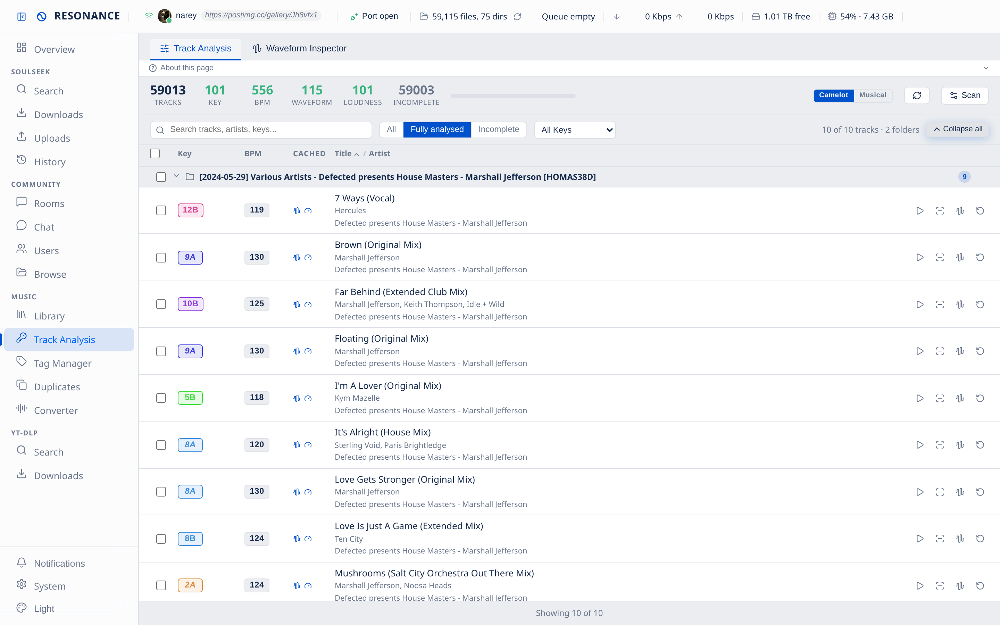
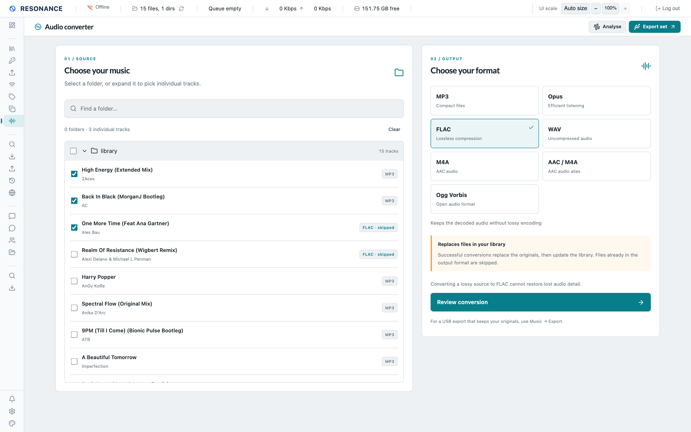

<div align="center">
  
  <h1>Resonance</h1>
  <p><strong>A self-hosted music library and DJ workspace with Soulseek built in.</strong></p>
  <p>Find music, prepare your collection, plan sets and rehearse transitions.</p>
  <p>
    <a href="#what-resonance-does">Features</a> ·
    <a href="#screenshots">Screenshots</a> ·
    <a href="#quick-start">Quick start</a> ·
    <a href="#documentation">Documentation</a> ·
    <a href="#development">Development</a> ·
    <a href="#license">License</a>
  </p>
  <p>
    
    
    
    
    <a href="LICENSE"></a>
  </p>
</div>

---

Resonance combines search and transfer management with a persistent music catalogue, automatic preparation, metadata enrichment, set planning and browser playback. The web workspace is designed for desktop screens; a separate Expo/React Native app provides mobile access. New installations use SQLite, with PostgreSQL available for existing or explicitly configured deployments.

Documentation updated **21 October 2026**. This is a snapshot of the current source, not a fixed feature commitment. Features, defaults, interfaces and compatibility can change as development continues.

Resonance is a modified version of [slskd](https://github.com/slskd/slskd). It is not maintained by, endorsed by, or affiliated with the slskd project or its author(s).

## What Resonance does

### Find and transfer

- Search Soulseek with inline filters for bitrate, size, duration, folder contents, encoding, and excluded terms.
- Browse a user's complete share tree and download individual files or entire folders.
- Manage live uploads and downloads with priorities, queue strategies, retry policies, speed limits, quotas, and time-based QoS.
- Protect the service with IP lists, user groups, leecher detection, and browse/search rate limiting.

### Organise and prepare

- Browse a SQLite- or PostgreSQL-backed catalogue by artist, album, genre, year, folder, or recently added.
- Automatically queue newly indexed tracks for analysis, including files arriving through Soulseek, `yt-dlp` and folders added under configured library roots.
- Prepare BPM, key, waveforms and loudness. Optional independent workers add beats/downbeats, genre, energy, vocal regions and phrase labels.
- Use saved table layouts, DJ filters, analysis status, track inspection and selection actions; build smart crates that update with the library.
- Edit tags in bulk and enrich metadata through MusicBrainz, Discogs, Last.fm, and Deezer.
- Convert audio, detect duplicates, and ingest tracks or subscriptions through `yt-dlp`.

### Plan and rehearse sets

- Compare key, tempo, genre evidence, energy and phrase timing before a transition.
- Preview the end of one track against the start of the next, with synced playback and a crossfader.
- Save and reorder set plans, then rehearse their handovers at one fixed master tempo, defaulting to the first track.
- See explicit warnings for genre mismatches, missing analysis and unsupported tempo/timing combinations. Compatibility suggestions do not guarantee a good musical blend.

### Play and share

- Use the docked player or a separate player window, with BPM/key/LUFS, level meters, queue controls and waveform seeking.
- Toggle beatgrids, vocal regions and coloured DJ or musical phrases; inspect waveform detail from Normal through 256×.
- Bypass all audio processing, or enable subtle adjustments and explicitly unlock advanced controls.
- Choose Daylight, AMOLED, Midnight, Ultraviolet or Ember themes. Interface scale makes the desktop workspace more compact, with 100% as normal size and an automatic sizing option.
- Cast to discovered DLNA renderers or expose the library as a DLNA/UPnP media server.
- Use the Expo/React Native companion app for search, transfers, playback, library browsing, chat, and administration.
- Create, edit, delete and publish mixtapes, with token-protected public playback and `.m3u` or `.zip` downloads.

### Prepare Pioneer exports

- Start a USB export from the library or the Export wizard, including tracks selected through folders.
- Prepare classic and OneLibrary databases, playlists, waveforms and beatgrids using the optional export worker.
- Use one desktop helper for USB transfer and Network Link. Network Link serves the prepared whole library and checks for updates automatically.

These Pioneer features are **experimental**. Physical player acceptance, including OPUS-QUAD, is still pending; network support depends on the player's LINK EXPORT capabilities. Installer signing and native Windows/Linux validation also remain outstanding. See the [helper guide](desktop/pioneer-link/README.md) before testing.

### Operate it your way

- Use JWT, API-key, or trusted reverse-proxy authentication with built-in and custom roles.
- Run a controller with remote transfer agents for distributed storage and downloads.
- Integrate FTP, webhooks, scripts, Pushbullet, Gluetun, UPnP, Prometheus, and Grafana Loki.
- Inspect transfer analytics, peer geography, queue health, events, logs, databases, and HTTP captures from the UI.
- Store logs in the database by default, or select Disk or Both. Migrate PostgreSQL data to a separate SQLite instance using the explicit migration tool.

The full, detailed capability list lives in [FEATURES.md](FEATURES.md).

## Screenshots

The checked-in screenshots were captured on 7 September 2026 and predate the current DJ workspace. They illustrate earlier screens; they are not a record of the latest layout or theme behaviour.

<div align="center">
  
  <p><em>The overview dashboard — transfer analytics, share ratio and catalogue reach.</em></p>
</div>

<details>
<summary><strong>More of the web app</strong></summary>

<br>

| | |
| :---: | :---: |
|  |  |
| **Library** — the persistent catalogue, by artist, album and genre | **Track analysis** — Camelot key and BPM per track, ready for harmonic mixing |
|  |  |
| **Search** — Soulseek results with filters for bitrate, format and free slots | **Duplicates** — grouped by track identity, with the best copy flagged |
|  | |
| **Converter** — transcode library folders in place | |

</details>

See the [screenshot guide](docs/screenshots/README.md) for capture instructions and privacy checks.

## Quick start

Resonance is currently aimed at self-hosters and developers. A local source setup needs:

- [.NET SDK 10](https://dotnet.microsoft.com/download)
- [Node.js 20+](https://nodejs.org/) and npm
- SQLite storage is included; PostgreSQL is optional
- Linux or macOS for the included shell scripts

```bash
git clone https://github.com/narey83/resonance.git
cd resonance

# Build the web app and backend. An explicit version keeps this working
# in fresh clones that do not have a release tag yet.
./bin/build --skip-tests --version 0.1.0-dev

# Start the combined backend and built web UI
./bin/run
```

Open the address reported at startup and complete the first-run setup wizard. Configure your shared library locations before expecting tracks to appear or be prepared.

Without database configuration, the backend creates `data/resonance.db` inside its application directory. Keep that directory on persistent storage. Existing PostgreSQL connection strings continue to select PostgreSQL; switching providers does not migrate data automatically. To use PostgreSQL explicitly:

```bash
export RESONANCE_DATABASE_CONNECTION_STRING='Host=localhost;Database=resonance;Username=resonance;Password=change-me'
./bin/run
```

The backend attempts to download its managed `ffmpeg` binary during the first build. Basic BPM/key analysis also needs the configured Essentia Python environment. Enhanced analysis needs separately installed model assets and workers; these are not provisioned by the source build. Metadata providers and other integrations may need credentials.

Basic analysis currently allows BPM/key tag writes by default. Set `analysis.write_to_tags` to `false` to retain those detections in the cache without writing them to the audio files. See [automatic preparation](docs/auto-analysis.md) for the configuration example and the distinction between indexing, basic analysis and enhanced analysis.

## Documentation

| Guide | Contents |
| --- | --- |
| [Feature inventory](FEATURES.md) | Current capabilities, configuration dependencies and experimental areas |
| [DJ workspace](docs/dj-workspace.md) | Library tools, set planning, rehearsal, player controls and worker setup |
| [Automatic preparation](docs/auto-analysis.md) | New-track detection, background work, retries and tag-writing behaviour |
| [Database architecture](docs/database/architecture.md) | SQLite/PostgreSQL selection, migration, backups and logging |
| [Pioneer helper](desktop/pioneer-link/README.md) | USB transfer, Network Link, pairing, installation and compatibility limits |
| [Beatgrid verification](docs/beatgrid-verification.md) | Repeatable rendering checks and what those checks establish |
| [Frontend development](frontend/README.md) | Local web development and focused test commands |

## Architecture

| Area | Technology | Responsibility |
| --- | --- | --- |
| `backend/` | ASP.NET Core, EF Core, SignalR | Soulseek networking, API, transfers, library, integrations, auth, and telemetry |
| `frontend/` | React, Semantic UI, Recharts | Desktop web workspace, library, playback, set planning, administration and analytics |
| `mobile/` | Expo, React Native | Native companion experience for Android and iOS |
| `desktop/pioneer-link/` | Go, native launcher and installer tooling | Shared USB transfer and local-network Pioneer helper |
| `tools/analysis-worker/` | Python, separately installed engines/models | Optional independent enhanced analysis |
| `tools/usb-export/` | Python | Experimental Pioneer database and analysis writers |
| `tools/DatabaseMigration/` | .NET | Explicit PostgreSQL-to-SQLite migration and validation |
| `extension/` | WebExtensions | Optional browser bridge for synchronising YouTube cookies |
| `tests/` | xUnit | Backend unit and integration coverage |
| `docker/` | Docker Compose, Caddy | Development deployment for the project's multi-network server environment |

Real-time browser and mobile updates travel over SignalR. SQLite or PostgreSQL stores application state, the library catalogue, transfer history, and analytics data; media remains on storage you control. Logging defaults to database storage, with Disk and Both modes available.

## Development

Start the backend from the repository root:

```bash
# Backend — http://localhost:5030 by default
dotnet run --project backend/resonance.csproj
```

In a second terminal, also starting at the repository root:

```bash
cd frontend
npm ci
npm start
```

The web development server runs on port 3000 and proxies API/SignalR requests to the backend on port 5030. For the separate mobile app, start another terminal at the repository root:

```bash
cd mobile
npm ci
npx expo start
```

Useful checks before submitting a change:

```bash
dotnet test tests/Resonance.Tests.csproj --configuration Release

cd frontend
npm run lint
npm run test-unattended

cd ../mobile
npx eslint .
npx tsc --noEmit
```

The Compose stack in [`docker/`](docker/) mirrors the maintainer's development server and expects pre-existing networks and local paths. Read [docker/README.md](docker/README.md) before using it; it is not a generic one-command production deployment.

## Security and privacy

Resonance is self-hosted: your database, credentials, catalogue, and media remain on infrastructure you operate. If you expose the service outside a trusted network, configure HTTPS, authentication, restrictive feature permissions, and a properly secured reverse proxy. API keys can be scoped by role and CIDR, and remote configuration and file management are independently opt-in.

Soulseek is a peer-to-peer network. Review the laws that apply where you live and share only material you have the right to distribute.

## Project lineage

Resonance is based on slskd and retains its AGPL obligations, attribution, and additional terms. The fork has its own name, visual identity, feature direction, and Soulseek client identifier. If you plan to redistribute or publish your own modified version, read [FORKING.md](FORKING.md) and the complete [LICENSE](LICENSE) first.

Changes specific to Resonance are tracked in [CHANGES.md](CHANGES.md), and third-party attribution is documented in [COPYRIGHT_TREE.md](COPYRIGHT_TREE.md).

## License

Licensed under the **GNU Affero General Public License v3.0 with Additional Terms**. See [LICENSE](LICENSE) for the complete terms.
