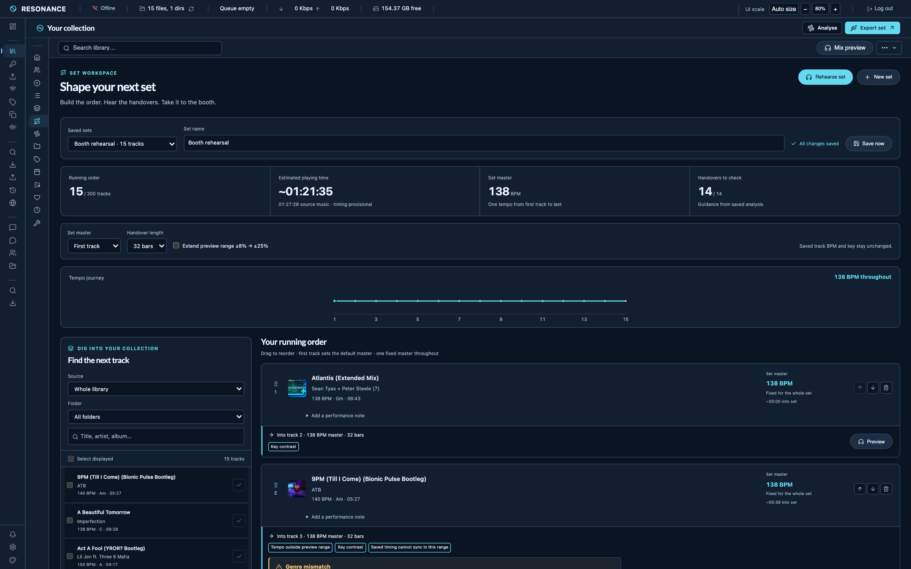
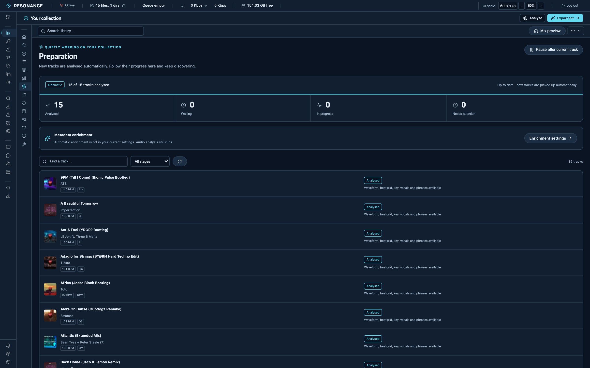
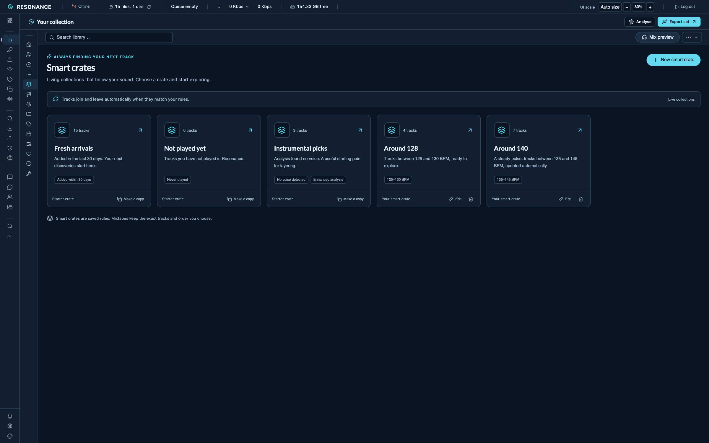
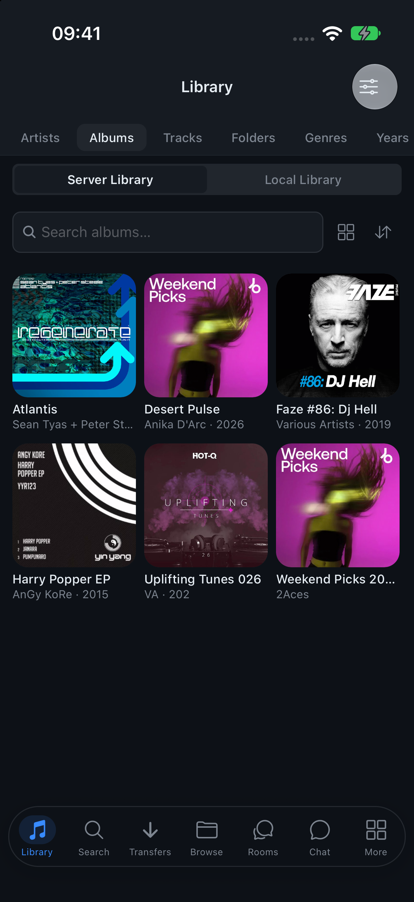
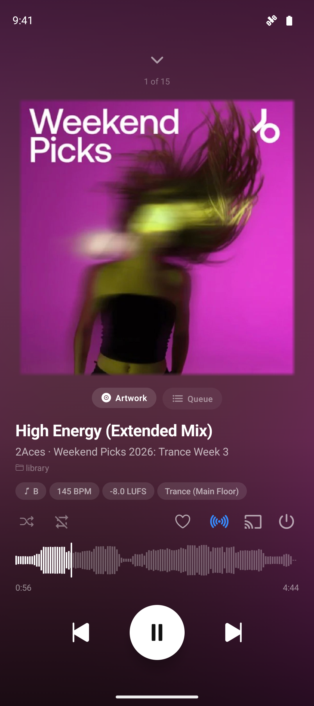
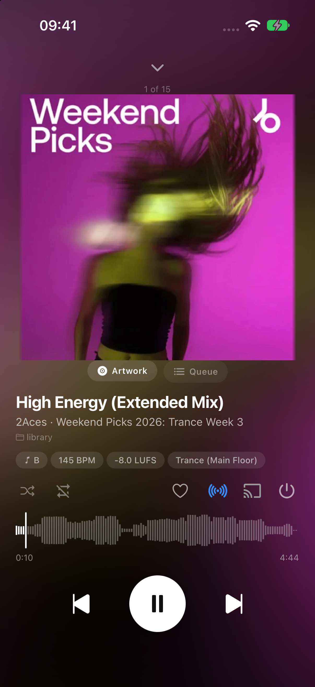

  
  <h1>Resonance</h1>
  
<strong>A self-hosted music streaming app with library management and DJ tools.</strong>

  
Stream your music, organise your collection, plan sets and rehearse transitions.

  

    <a href="#what-resonance-does">Features</a> ·
    <a href="#screenshots">Screenshots</a> ·
    <a href="#architecture">Architecture</a> ·
    <a href="#license">License</a>
  

  

    
    
    
    
    
    
  

---

> **Pre-beta status:** Resonance is still in development. This GitHub repository
> shares the project overview, app screenshots and licence. The source code and
> other project files are kept on private local infrastructure until beta testing
> is ready. There is no public download yet.

**Resonance is an actively developed, experimental music platform.**

Resonance is an ongoing project exploring a modern music listening experience, combining music management, playback, audio processing, visualisation and intelligent music analysis.

The project is currently in development. Features, architecture and interfaces are subject to change, and it is not yet intended for production use.

I'm sharing development progress here and welcome interest from other developers and music enthusiasts.

### Current status

- 🚧 Currently in development
- 🧪 Experimental features
- 🛠️ Architecture and functionality evolving

Resonance brings together music streaming, a persistent music catalogue, automatic preparation, metadata enrichment and set planning. Its Soulseek integration provides network search, shared-folder browsing, transfers and community features. The web workspace is designed for desktop screens; a separate Expo/React Native app provides mobile access. The application uses SQLite by default, with PostgreSQL also supported.

Documentation updated **21 October 2026**. This is a snapshot of the current source, not a fixed feature commitment. Features, defaults, interfaces and compatibility can change as development continues.

Resonance is a modified version of [slskd](https://github.com/slskd/slskd). It is not maintained by, endorsed by, or affiliated with the slskd project or its author(s).

## What Resonance does

### Find and transfer

- Search Soulseek with inline filters for bitrate, size, duration, folder contents, encoding, and excluded terms.
- Browse a user's complete share tree and download individual files or entire folders.
- Manage live uploads and downloads with priorities, queue strategies, retry policies, speed limits, quotas, and time-based QoS.
- Protect the service with IP lists, user groups, leecher detection, and browse/search rate limiting.

### Organise and prepare

- Browse a SQLite- or PostgreSQL-backed catalogue by artist, album, genre, year, folder, or recently added.
- Automatically queue newly indexed tracks for analysis, including files arriving through Soulseek, `yt-dlp` and folders added under configured library roots.
- Prepare BPM, key, waveforms and loudness. Optional independent workers add beats/downbeats, genre, energy, vocal regions and phrase labels.
- Use saved table layouts, DJ filters, analysis status, track inspection and selection actions; build smart crates that update with the library.
- Edit tags in bulk and enrich metadata through MusicBrainz, Discogs, Last.fm, and Deezer.
- Convert audio, detect duplicates, and ingest tracks or subscriptions through `yt-dlp`.

### Plan and rehearse sets

- Compare key, tempo, genre evidence, energy and phrase timing before a transition.
- Preview the end of one track against the start of the next, with synced playback and a crossfader.
- Save and reorder set plans, then rehearse their handovers at one fixed master tempo, defaulting to the first track.
- See explicit warnings for genre mismatches, missing analysis and unsupported tempo/timing combinations. Compatibility suggestions do not guarantee a good musical blend.

### Play and share

- Use the docked player with BPM/key/LUFS, level meters, queue controls and waveform seeking.
- Toggle beatgrids, vocal regions and coloured DJ or musical phrases; inspect waveform detail from Normal through 256×.
- Bypass all audio processing, or enable subtle adjustments and explicitly unlock advanced controls.
- Choose Daylight, AMOLED, Midnight, Ultraviolet or Ember themes. Interface scale makes the desktop workspace more compact, with 100% as normal size and an automatic sizing option.
- Cast to discovered DLNA renderers or expose the library as a DLNA/UPnP media server.
- Use the Expo/React Native companion app for search, transfers, playback, library browsing, chat, and administration.
- Create, edit, delete and publish mixtapes, with token-protected public playback and `.m3u` or `.zip` downloads.

### Prepare DJ hardware exports

- Start a USB export from the library or the Export wizard, including tracks selected through folders.
- Prepare classic and OneLibrary databases, playlists, waveforms and beatgrids using the optional export worker.
- Use one desktop helper for USB transfer and Network Link. Network Link serves the prepared whole library and checks for updates automatically.

These DJ hardware features are **experimental**. Physical player acceptance is still pending; network support depends on the player's LINK EXPORT capabilities. Installer signing and native Windows/Linux validation also remain outstanding.

### Take the library mobile

- Use the Android or iOS companion app to browse your server library, stream music and manage mixtapes.
- Open a full-screen player with artwork, waveform seeking, queue controls and available BPM, key, LUFS and genre information.
- Search Soulseek, manage server transfers, browse shares, use rooms/chat and access administration according to your role.
- Choose Light, Dark, AMOLED, Midnight or system appearance, and Automatic, Original or Data saver streaming quality.
- Android also implements a local audio library, Android Auto, an optional player overlay over other apps and copying local tracks to a chosen folder or USB storage. These have different platform requirements from iOS and from the desktop DJ hardware export.

The apps are in active development: features and design can change, with more features being added.

### Operate it your way

- Use JWT, API-key, or trusted reverse-proxy authentication with built-in and custom roles.
- Run a controller with remote transfer agents for distributed storage and downloads.
- Integrate FTP, webhooks, scripts, Pushbullet, Gluetun, UPnP, Prometheus, and Grafana Loki.
- Inspect transfer analytics, peer geography, queue health, events, logs, databases, and HTTP captures from the UI.
- Store logs in the database by default, or select Disk or Both. Migrate PostgreSQL data to a separate SQLite instance using the explicit migration tool.

## Screenshots

Captured **21 October 2026** from the isolated 15-track test library, with enhanced analysis and export workers configured. The gallery shows the current desktop design in Midnight and Daylight. Screens and features can change as development continues.

  
  
<em>The music workspace: analysed tracks, a persistent player and phrase-coloured waveforms.</em>

<strong>Explore the library, player and DJ tools</strong>

 

| | |
| :---: | :---: |
|  |  |
| **Album browser** — artwork and collection browsing in Daylight | **Docked player** — playback, waveform controls and metering |
|  |  |
| **Set planner** — build the order and review each transition | **Full-set rehearsal** — audition consecutive handovers at one master tempo |
|  |  |
| **Mix compatibility** — compare tempo, key and suggested handover regions | **Preparation** — automatic analysis progress, status and retry controls |
|  |  |
| **Smart crates** — collections that follow saved library rules | **Audio converter** — source selection, format settings and conversion jobs |
|  |  |
| **USB Export** — select folders and tracks, then prepare a player export | **Network Link** — prepare the whole library for the shared desktop helper |

Capture instructions and privacy checks are kept with the private source.

### Android and iOS

Native development builds captured **21 October 2026** against the same 15-track test library. Android uses a Pixel 9 emulator; iOS uses an iPhone 17 simulator. These show the current apps, whose features and design continue to grow and change.

| Android | iOS |
| :---: | :---: |
|  |  |
| **Android library** | **iOS library** |
|  |  |
| **Android player** | **iOS player** |

Simulator captures do not imply store availability or verification of vehicle, casting, push or USB hardware integrations.

## Architecture

Implementation files are kept in the private source repository until beta testing.

| Area | Technology | Responsibility |
| --- | --- | --- |
| `backend/` | ASP.NET Core, EF Core, SignalR | Soulseek networking, API, transfers, library, integrations, auth, and telemetry |
| `frontend/` | React, Semantic UI, Recharts | Desktop web workspace, library, playback, set planning, administration and analytics |
| `mobile/` | Expo, React Native | Native companion experience for Android and iOS |
| `desktop/bridge/` | Go, native launcher and installer tooling | Resonance Bridge desktop app, USB transfer and device integration |
| `tools/analysis-worker/` | Python, separately installed engines/models | Optional independent enhanced analysis |
| `tools/usb-export/` | Python | Experimental DJ hardware database and analysis writers |
| `tools/DatabaseMigration/` | .NET | Explicit PostgreSQL-to-SQLite migration and validation |
| `extension/` | WebExtensions | Optional browser bridge for synchronising YouTube cookies |
| `tests/` | xUnit | Backend unit and integration coverage |
| `docker/` | Docker Compose, Caddy | Portable live development stack and server deployment configuration |

Real-time browser and mobile updates travel over SignalR. SQLite or PostgreSQL stores application state, the library catalogue, transfer history, and analytics data; media remains on storage you control. Logging defaults to database storage, with Disk and Both modes available.

## Security and privacy

Resonance is self-hosted: your database, credentials, catalogue, and media remain on infrastructure you operate. Soulseek is a peer-to-peer network.

## Project lineage

Resonance is based on slskd and retains its AGPL obligations, attribution, and additional terms. The fork has its own name, visual identity, feature direction, and Soulseek client identifier. The complete terms are in the public [LICENSE](LICENSE).

Source-level change history and third-party attribution are kept with the private project files.

## License

Licensed under the **GNU Affero General Public License v3.0 with Additional Terms**. See [LICENSE](LICENSE) for the complete terms.
