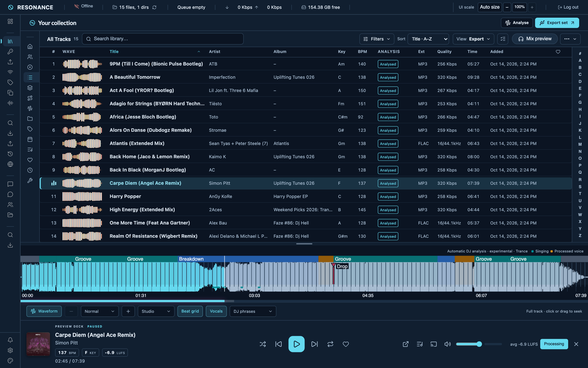
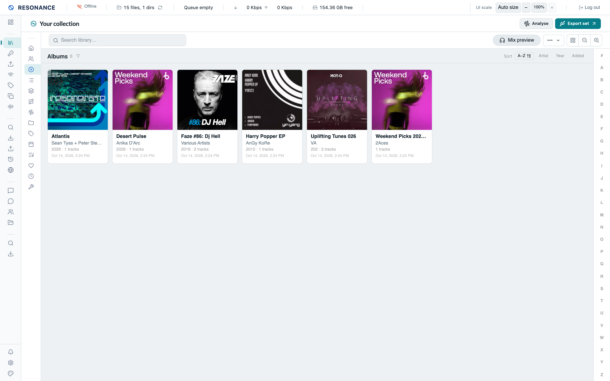
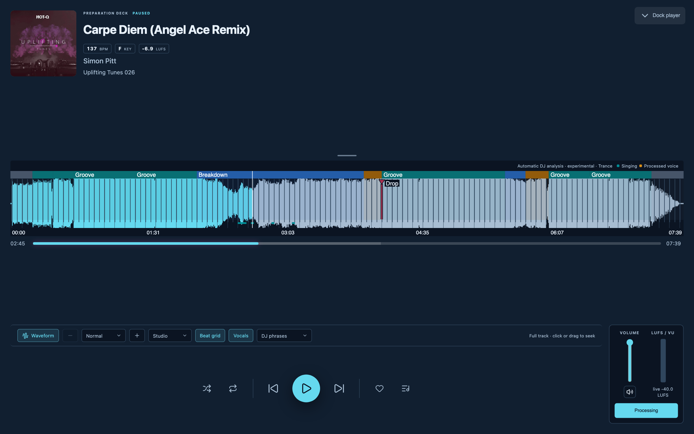
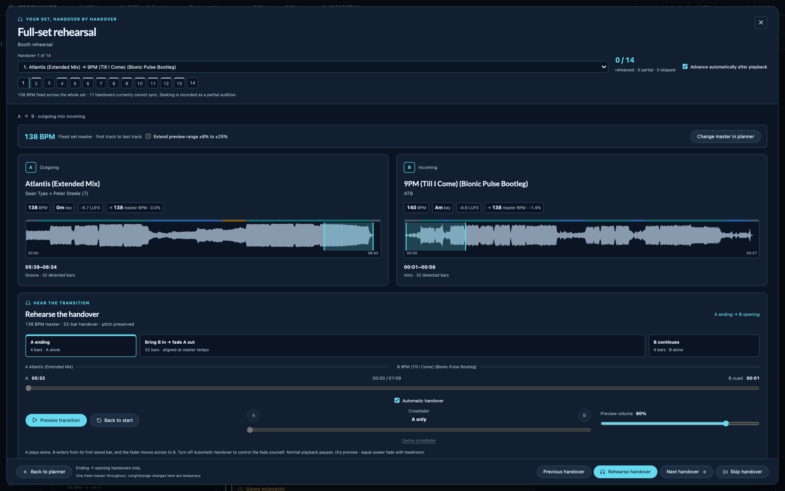
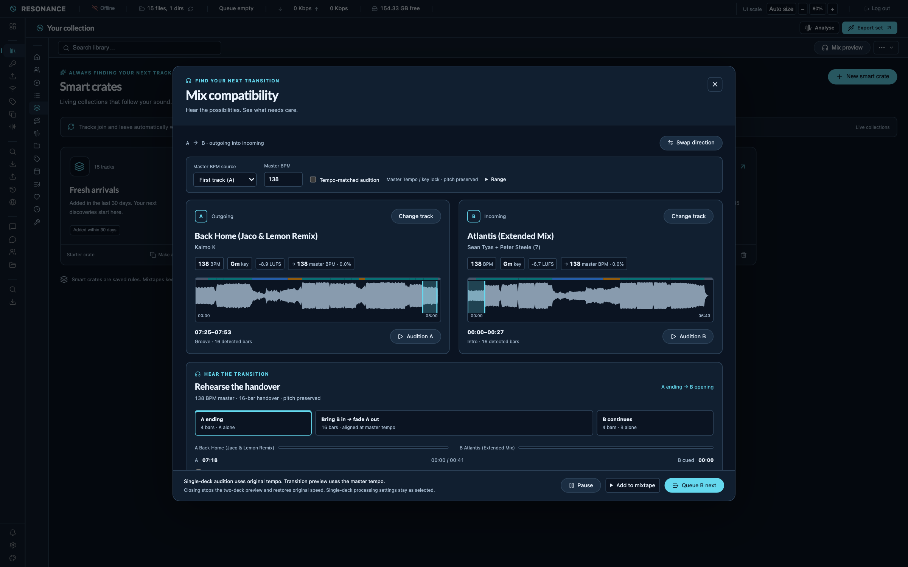
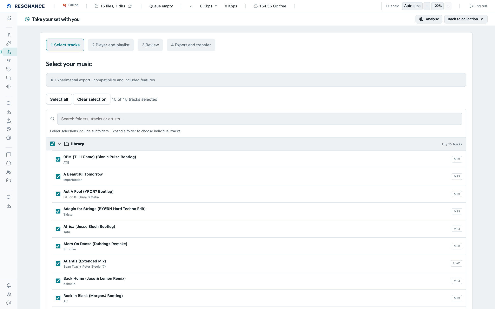
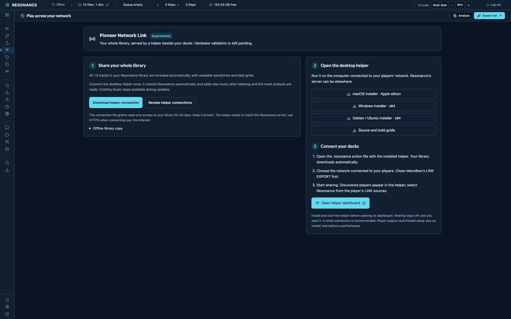
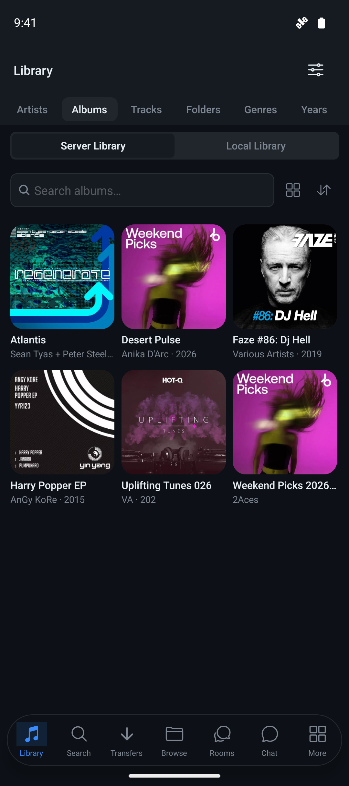

<div align="center">
  
  <h1>Resonance</h1>
  <p><strong>A self-hosted music library and DJ workspace with Soulseek built in.</strong></p>
  <p>Find music, prepare your collection, plan sets and rehearse transitions.</p>
  <p>
    <a href="#what-resonance-does">Features</a> ·
    <a href="#screenshots">Screenshots</a> ·
    <a href="#quick-start">Quick start</a> ·
    <a href="#documentation">Documentation</a> ·
    <a href="#development">Development</a> ·
    <a href="#license">License</a>
  </p>
  <p>
    
    
    
    
    <a href="LICENSE"></a>
  </p>
</div>

---

Resonance combines search and transfer management with a persistent music catalogue, automatic preparation, metadata enrichment, set planning and browser playback. The web workspace is designed for desktop screens; a separate Expo/React Native app provides mobile access. New installations use SQLite, with PostgreSQL available for existing or explicitly configured deployments.

Documentation updated **21 October 2026**. This is a snapshot of the current source, not a fixed feature commitment. Features, defaults, interfaces and compatibility can change as development continues.

Resonance is a modified version of [slskd](https://github.com/slskd/slskd). It is not maintained by, endorsed by, or affiliated with the slskd project or its author(s).

## What Resonance does

### Find and transfer

- Search Soulseek with inline filters for bitrate, size, duration, folder contents, encoding, and excluded terms.
- Browse a user's complete share tree and download individual files or entire folders.
- Manage live uploads and downloads with priorities, queue strategies, retry policies, speed limits, quotas, and time-based QoS.
- Protect the service with IP lists, user groups, leecher detection, and browse/search rate limiting.

### Organise and prepare

- Browse a SQLite- or PostgreSQL-backed catalogue by artist, album, genre, year, folder, or recently added.
- Automatically queue newly indexed tracks for analysis, including files arriving through Soulseek, `yt-dlp` and folders added under configured library roots.
- Prepare BPM, key, waveforms and loudness. Optional independent workers add beats/downbeats, genre, energy, vocal regions and phrase labels.
- Use saved table layouts, DJ filters, analysis status, track inspection and selection actions; build smart crates that update with the library.
- Edit tags in bulk and enrich metadata through MusicBrainz, Discogs, Last.fm, and Deezer.
- Convert audio, detect duplicates, and ingest tracks or subscriptions through `yt-dlp`.

### Plan and rehearse sets

- Compare key, tempo, genre evidence, energy and phrase timing before a transition.
- Preview the end of one track against the start of the next, with synced playback and a crossfader.
- Save and reorder set plans, then rehearse their handovers at one fixed master tempo, defaulting to the first track.
- See explicit warnings for genre mismatches, missing analysis and unsupported tempo/timing combinations. Compatibility suggestions do not guarantee a good musical blend.

### Play and share

- Use the docked player or a separate player window, with BPM/key/LUFS, level meters, queue controls and waveform seeking.
- Toggle beatgrids, vocal regions and coloured DJ or musical phrases; inspect waveform detail from Normal through 256×.
- Bypass all audio processing, or enable subtle adjustments and explicitly unlock advanced controls.
- Choose Daylight, AMOLED, Midnight, Ultraviolet or Ember themes. Interface scale makes the desktop workspace more compact, with 100% as normal size and an automatic sizing option.
- Cast to discovered DLNA renderers or expose the library as a DLNA/UPnP media server.
- Use the Expo/React Native companion app for search, transfers, playback, library browsing, chat, and administration.
- Create, edit, delete and publish mixtapes, with token-protected public playback and `.m3u` or `.zip` downloads.

### Prepare DJ hardware exports

- Start a USB export from the library or the Export wizard, including tracks selected through folders.
- Prepare classic and OneLibrary databases, playlists, waveforms and beatgrids using the optional export worker.
- Use one desktop helper for USB transfer and Network Link. Network Link serves the prepared whole library and checks for updates automatically.

These DJ hardware features are **experimental**. Physical player acceptance is still pending; network support depends on the player's LINK EXPORT capabilities. Installer signing and native Windows/Linux validation also remain outstanding. See the [Resonance Bridge guide](desktop/bridge/README.md) before testing.

### Take the library mobile

- Use the Android or iOS companion app to browse your server library, stream music and manage mixtapes.
- Open a full-screen player with artwork, waveform seeking, queue controls and available BPM, key, LUFS and genre information.
- Search Soulseek, manage server transfers, browse shares, use rooms/chat and access administration according to your role.
- Choose Light, Dark, AMOLED, Midnight or system appearance, and Automatic, Original or Data saver streaming quality.
- Android also implements a local audio library, Android Auto, an optional player overlay over other apps and copying local tracks to a chosen folder or USB storage. These have different platform requirements from iOS and from the desktop DJ hardware export.

See the [mobile feature guide and platform comparison](mobile/README.md). The apps are in active development: features and design can change, with more features being added.

### Operate it your way

- Use JWT, API-key, or trusted reverse-proxy authentication with built-in and custom roles.
- Run a controller with remote transfer agents for distributed storage and downloads.
- Integrate FTP, webhooks, scripts, Pushbullet, Gluetun, UPnP, Prometheus, and Grafana Loki.
- Inspect transfer analytics, peer geography, queue health, events, logs, databases, and HTTP captures from the UI.
- Store logs in the database by default, or select Disk or Both. Migrate PostgreSQL data to a separate SQLite instance using the explicit migration tool.

The full, detailed capability list lives in [FEATURES.md](FEATURES.md).

## Screenshots

Captured **21 October 2026** from the isolated 15-track test library, with enhanced analysis and export workers configured. The gallery shows the current desktop design in Midnight and Daylight. Screens and features can change as development continues.

<div align="center">
  <a href="docs/screenshots/library.png"></a>
  <p><em>The music workspace: analysed tracks, a persistent player and phrase-coloured waveforms.</em></p>
</div>

<details>
<summary><strong>Explore the library, player and DJ tools</strong></summary>

<br>

| | |
| :---: | :---: |
| <a href="docs/screenshots/albums.png"></a> | <a href="docs/screenshots/player.png"></a> |
| **Album browser** — artwork and collection browsing in Daylight | **Player window** — dedicated playback, waveform controls and metering |
| <a href="docs/screenshots/set-planner.png"></a> | <a href="docs/screenshots/set-rehearsal.png"></a> |
| **Set planner** — build the order and review each transition | **Full-set rehearsal** — audition consecutive handovers at one master tempo |
| <a href="docs/screenshots/mix-preview.png"></a> | <a href="docs/screenshots/preparation.png"></a> |
| **Mix compatibility** — compare tempo, key and suggested handover regions | **Preparation** — automatic analysis progress, status and retry controls |
| <a href="docs/screenshots/smart-crates.png"></a> | <a href="docs/screenshots/converter.png"></a> |
| **Smart crates** — collections that follow saved library rules | **Audio converter** — source selection, format settings and conversion jobs |
| <a href="docs/screenshots/export.png"></a> | <a href="docs/screenshots/network-link.png"></a> |
| **USB Export** — select folders and tracks, then prepare a player export | **Network Link** — prepare the whole library for the shared desktop helper |

</details>

See the [screenshot guide](docs/screenshots/README.md) for capture instructions and privacy checks.

### Android and iOS

Native development builds captured **21 October 2026** against the same 15-track test library. Android uses a Pixel 9 emulator; iOS uses an iPhone 17 simulator. These show the current apps, whose features and design continue to grow and change.

| Android | iOS |
| :---: | :---: |
| <a href="docs/screenshots/mobile/android/albums.png"></a> | <a href="docs/screenshots/mobile/ios/albums.png"></a> |
| **Android library** | **iOS library** |
| <a href="docs/screenshots/mobile/android/player.png"></a> | <a href="docs/screenshots/mobile/ios/player.png"></a> |
| **Android player** | **iOS player** |

Explore [all mobile screenshots, features and platform differences](mobile/README.md), including tracks, queue, mixtapes and light-mode preferences. Simulator captures do not imply store availability or verification of vehicle, casting, push or USB hardware integrations.

## Quick start

For a new Linux Docker host using an existing SMB music share, run `python3 docker/bootstrap.py` after cloning this repository. The host needs Python 3 and Docker Compose; the SDKs and analysis tools build inside containers. See the [portable stack guide](docker/PORTABLE_STACK.md). It builds the tools, installs verified models, configures analysis and uses persistent Docker mounts and reboot startup. Private state export/import carries the existing SQLite instance across separately from GitHub.

Resonance is currently aimed at self-hosters and developers. A local source setup needs:

- [.NET SDK 10](https://dotnet.microsoft.com/download)
- [Node.js 20+](https://nodejs.org/) and npm
- SQLite storage is included; PostgreSQL is optional
- Linux or macOS for the included shell scripts

```bash
git clone https://github.com/narey83/resonance.git
cd resonance

# Build the web app and backend. An explicit version keeps this working
# in fresh clones that do not have a release tag yet.
./bin/build --skip-tests --version 0.1.0-dev

# Start the combined backend and built web UI
./bin/run
```

Open the address reported at startup and complete the first-run setup wizard. Configure your shared library locations before expecting tracks to appear or be prepared.

Without database configuration, the backend creates `data/resonance.db` inside its application directory. Keep that directory on persistent storage. Existing PostgreSQL connection strings continue to select PostgreSQL; switching providers does not migrate data automatically. To use PostgreSQL explicitly:

```bash
export RESONANCE_DATABASE_CONNECTION_STRING='Host=localhost;Database=resonance;Username=resonance;Password=change-me'
./bin/run
```

The backend attempts to download its managed `ffmpeg` binary during the first build. Basic BPM/key analysis also needs the configured Essentia Python environment. Enhanced analysis needs separately installed model assets and workers; these are not provisioned by the source build. Metadata providers and other integrations may need credentials.

Basic analysis currently allows BPM/key tag writes by default. Set `analysis.write_to_tags` to `false` to retain those detections in the cache without writing them to the audio files. See [automatic preparation](docs/auto-analysis.md) for the configuration example and the distinction between indexing, basic analysis and enhanced analysis.

## Documentation

| Guide | Contents |
| --- | --- |
| [Feature inventory](FEATURES.md) | Current capabilities, configuration dependencies and experimental areas |
| [DJ workspace](docs/dj-workspace.md) | Library tools, set planning, rehearsal, player controls and worker setup |
| [Automatic preparation](docs/auto-analysis.md) | New-track detection, background work, retries and tag-writing behaviour |
| [Database architecture](docs/database/architecture.md) | SQLite/PostgreSQL selection, migration, backups and logging |
| [Resonance Bridge](desktop/bridge/README.md) | USB transfer, Network Link, pairing, installation and compatibility limits |
| [Beatgrid verification](docs/beatgrid-verification.md) | Repeatable rendering checks and what those checks establish |
| [Frontend development](frontend/README.md) | Local web development and focused test commands |
| [Mobile apps](mobile/README.md) | Native Android/iOS screenshots, current features and platform differences |
| [Mobile development](mobile/EXPO_GUIDE.md) | Expo SDK requirements, native builds and device connectivity |

## Architecture

| Area | Technology | Responsibility |
| --- | --- | --- |
| `backend/` | ASP.NET Core, EF Core, SignalR | Soulseek networking, API, transfers, library, integrations, auth, and telemetry |
| `frontend/` | React, Semantic UI, Recharts | Desktop web workspace, library, playback, set planning, administration and analytics |
| `mobile/` | Expo, React Native | Native companion experience for Android and iOS |
| `desktop/bridge/` | Go, native launcher and installer tooling | Resonance Bridge desktop app, USB transfer and device integration |
| `tools/analysis-worker/` | Python, separately installed engines/models | Optional independent enhanced analysis |
| `tools/usb-export/` | Python | Experimental DJ hardware database and analysis writers |
| `tools/DatabaseMigration/` | .NET | Explicit PostgreSQL-to-SQLite migration and validation |
| `extension/` | WebExtensions | Optional browser bridge for synchronising YouTube cookies |
| `tests/` | xUnit | Backend unit and integration coverage |
| `docker/` | Docker Compose, Caddy | Portable live development stack and server deployment configuration |

Real-time browser and mobile updates travel over SignalR. SQLite or PostgreSQL stores application state, the library catalogue, transfer history, and analytics data; media remains on storage you control. Logging defaults to database storage, with Disk and Both modes available.

## Development

For this workspace, the Mac checkout at `/Users/narey/Projects/resonance` is the source of truth. Develop, build and verify changes locally, then commit and push to GitHub (`narey83/resonance`, `main`) for publication and distribution. Preserve local work and deliberately reconcile any incoming changes; do not overwrite the Mac checkout to match GitHub. The former development-server checkout and VS Code Remote SSH workflow are no longer used. See [the agent build guide](.agents/BUILD_AND_DEPLOY.md) for local verification requirements.

Git synchronization does not deploy a running application. The existing server uses native processes; historical Docker deployment instructions apply only to installations that explicitly use that setup. Before using `bin/dev`, check that private `.dev/config.json` selects a local runtime: historical `remote` and `server` modes invoke remote helpers.

Manage the local backend, web UI and mobile Metro server from the repository root:

```bash
./bin/dev start
./bin/dev status
./bin/dev restart
./bin/dev stop
```

You can target one service, for example `./bin/dev restart mobile` or `./bin/dev stop web`. After restarting your computer, run `./bin/dev start` again. This does not install an automatic login service.

The managed backend uses .NET watch with clean process restarts when C# files change. In-process hot reload is disabled to avoid runtime metadata failures during concurrent development builds. It uses port **55450**, the web UI uses **3000**, and Metro uses **8081**. Logs, process state, configuration and persistent backend data live in ignored `.dev/`, rather than temporary storage. Open **http://localhost:3000** for the web UI; mobile clients connect to **http://localhost:55450** in the iOS simulator or **http://10.0.2.2:55450** in the standard Android emulator. A new data directory needs the usual first-run server setup.

Install frontend/mobile dependencies with `npm ci` in each directory first. The script requires Python 3, Node/npm and .NET 10. It finds `dotnet` on PATH or in conventional user installation directories; for a custom SDK, set `"dotnet": "/absolute/path/to/dotnet"` in `.dev/config.json`. You can also change ports or `appDir` there while the services are stopped. The default bind address is loopback. To test physical phones on your trusted local network, set `"bindAddress": "0.0.0.0"`, restart the services, and connect the phone to `http://<your-Mac-LAN-IP>:55450`. This exposes the authenticated dev API and the web dev server to that network; use loopback again afterwards. Stop only affects processes started by this script; occupied ports belonging to other processes are left untouched.

For manual development:

Start the backend from the repository root:

```bash
# Backend — http://localhost:5030 by default
dotnet run --project backend/resonance.csproj
```

In a second terminal, also starting at the repository root:

```bash
cd frontend
npm ci
npm start
```

The web development server runs on port 3000 and proxies API/SignalR requests to the backend on port 5030. For the separate mobile app, first install a compatible native development build using the [mobile development guide](mobile/EXPO_GUIDE.md), then start Metro from another terminal:

```bash
cd mobile
npm ci
npx expo start --dev-client
```

Useful checks before submitting a change:

```bash
dotnet test tests/Resonance.Tests.csproj --configuration Release

cd frontend
npm run lint
npm run test-unattended

cd ../mobile
npx eslint .
npx tsc --noEmit
```

For live development in Docker, run `./bin/dev-container build` then `./bin/dev-container start`. The portable stack bind-mounts source, reloads backend/web changes and preserves app data under `.dev/docker/app`; its default web/API ports are 3001/55451. Expo Metro stays on the host for iOS/Android simulators. See [docker/README.md](docker/README.md) for commands, data migration and local configuration. The older server Compose file remains separate and expects the maintainer's existing networks and paths.

## Security and privacy

Resonance is self-hosted: your database, credentials, catalogue, and media remain on infrastructure you operate. If you expose the service outside a trusted network, configure HTTPS, authentication, restrictive feature permissions, and a properly secured reverse proxy. API keys can be scoped by role and CIDR, and remote configuration and file management are independently opt-in.

Soulseek is a peer-to-peer network. Review the laws that apply where you live and share only material you have the right to distribute.

## Project lineage

Resonance is based on slskd and retains its AGPL obligations, attribution, and additional terms. The fork has its own name, visual identity, feature direction, and Soulseek client identifier. If you plan to redistribute or publish your own modified version, read [FORKING.md](FORKING.md) and the complete [LICENSE](LICENSE) first.

Changes specific to Resonance are tracked in [CHANGES.md](CHANGES.md), and third-party attribution is documented in [COPYRIGHT_TREE.md](COPYRIGHT_TREE.md).

## License

Licensed under the **GNU Affero General Public License v3.0 with Additional Terms**. See [LICENSE](LICENSE) for the complete terms.

### API security and deployment

Deploy the server, web build and mobile client changes together: chat badges use the joined-room counter endpoint, and private playlist artwork uses expiring scoped signatures supplied by authenticated playlist responses. Public playlist artwork continues to use its public sharing token. Diagnostics and HTTP capture exports require an administrator. Logout and role changes revoke persisted sessions and close affected live connections.

Same-origin web hosting and native mobile clients need no CORS configuration. For a separately hosted web UI, explicitly list its origin in `web.cors_origins`; unlisted browser origins cannot open hub connections. For example:

```yaml
web:
  cors_origins:
    - https://music.example.com
```

Track pages are capped at 10,000 entries; signing requests accept up to 1,000 paths, with clients batching larger selections. Transcoding permits four concurrent FFmpeg processes and returns HTTP 429 with a retry delay when full.

Artwork processing uses SkiaSharp, including Linux native assets, instead of ImageSharp. No Six Labors license key is required. Test native image decoding on each deployment platform when changing runtime packaging.

On macOS, install native FFmpeg and ffprobe with `brew install ffmpeg`, or configure `ffmpeg.path` to the FFmpeg executable with ffprobe alongside it. The managed downloader supplies Windows/Linux builds and deliberately does not install those on macOS. Standard Homebrew bin directories are checked even when a GUI process has a minimal PATH.

Container images bundle verified yt-dlp, Deno, FFmpeg and ffprobe. First startup copies these tools into the writable data volume, so it works without downloading executables at runtime. Missing tools on native installs are downloaded when needed (macOS FFmpeg still uses the native installation described above). Managed tools check for updates at startup and periodically, downloading verified replacements automatically when their auto-update options are enabled. User-configured/system executables are reused rather than overwritten. Keep the app data volume across container recreations; see [container dependency setup](docker/README.md#media-tool-dependencies).
