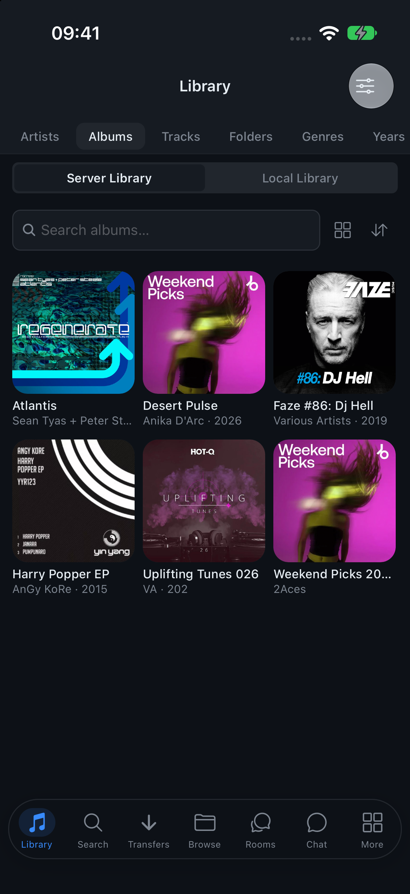
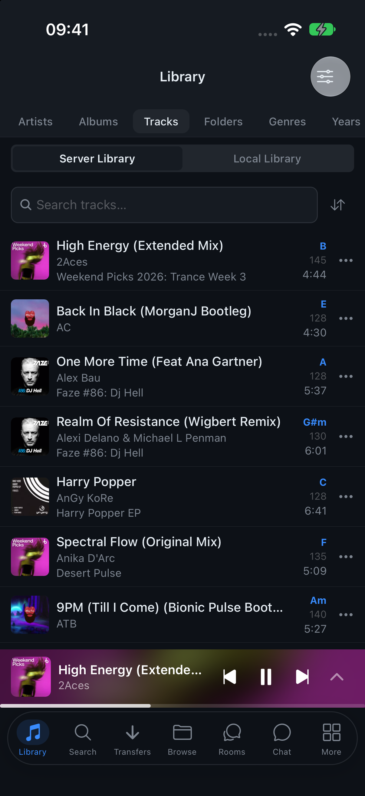
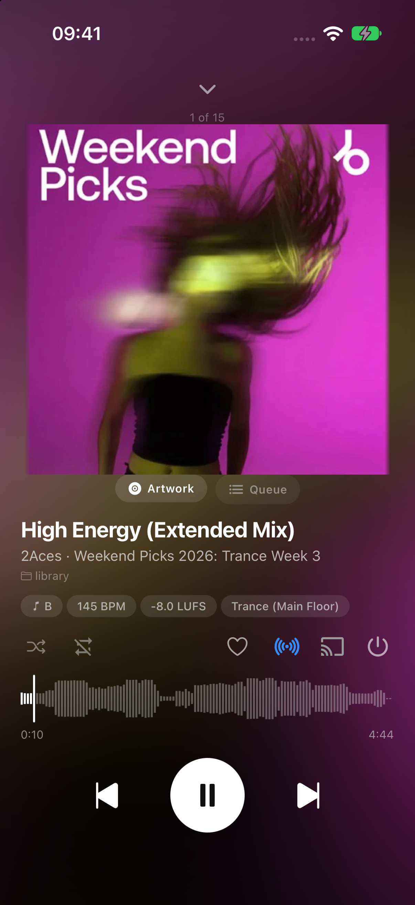
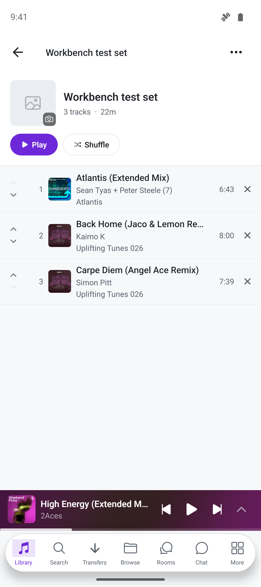
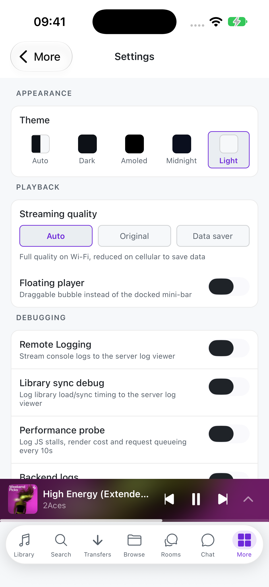

# Resonance mobile

The Android and iOS companion apps bring your Resonance library, playback, Soulseek transfers and community tools to a phone. They connect to a Resonance server; the desktop web workspace remains the home for the larger DJ preparation and rehearsal tools.

Updated **24 October 2026**. These features and screenshots describe the current development builds. Features and design can change, and more features are being added. Platform support depends on the native build, permissions and server configuration.

## Screenshots

Captured from the native apps connected to the isolated 15-track test library: Pixel 9 / Android 16 and iPhone 17 / iOS 27 simulators. These are native development-build captures, not phone-sized web pages. Select an image to view it at full resolution.

| Android | iOS |
| :---: | :---: |
|  |  |
| **Albums** — artwork tiles, search and library sources | **Albums** — native iOS navigation and artwork browsing |
|  |  |
| **Tracks** — analysed metadata and persistent playback controls | **Tracks** — the same server catalogue on iPhone |
|  |  |
| **Player** — artwork, waveform seeking and track information | **Player** — full-screen playback and casting control |
|  |  |
| **Queue** — switch between artwork and the running order | **Queue** — select the next track without leaving the player |
|  |  |
| **Playlists** — saved collections and ordering controls | **Playlists** — play, shuffle and edit a saved collection |
|  |  |
| **Preferences** — appearance and playback choices | **Preferences** — Light, Dark, AMOLED, Midnight or system appearance |

Capture dates, device details and scope are recorded in the [mobile screenshot guide](../docs/screenshots/mobile/README.md) and its manifest. This gallery verifies the displayed screens; it does not certify every feature or external device integration.

## Shared companion features

| Area | Current functionality |
| --- | --- |
| Connection | Enter a server address and sign in, or scan a short-lived pairing QR from the web app. Sessions use secure device storage. |
| Server library | Browse artists, albums, tracks, folders, genres and years. Search and sort within views; choose list or artwork tiles where available. |
| Track information | Show BPM, key, genre and loudness when the server has supplied them. Analysis status and library updates arrive through the server connection. |
| Playback | Mini-player and full-screen player, waveform seeking, queue selection, previous/next, shuffle, repeat and loved tracks. Native playback service handles background and remote controls. |
| Streaming | Automatic, Original and Data saver modes. Automatic prefers original quality on Wi-Fi and smaller streams on cellular; transcoding requires the server's media tools. |
| Playlists | Create, rename and delete playlists; add, remove and reorder tracks; play or shuffle a collection. Publishing and sharing use server permissions. |
| Casting | Google Cast controls for compatible receivers on a reachable network. This differs from the desktop web app's DLNA controls. |
| Soulseek | Search, filter results, browse shared folders and manage server transfers. The Resonance server maintains the Soulseek connection. |
| Community | Rooms, mentions, private conversations and unread indicators, with live updates. |
| Administration | Role-dependent overview, server status, connection, logs and relay controls. These entries are hidden from accounts without the required role. |
| Preferences | Match handset light/dark mode, Light, Dark, AMOLED and Midnight appearances, six adaptive accent colours, mini-bar or experimental floating player, notification preferences and optional diagnostic logging. |
| Local cache | Offline playlist audio is explicitly downloaded in Discover → Offline. SQLite metadata and artwork caches speed up repeat browsing. Cached server metadata is not an offline download of the audio. |

## Discovery and preparation

The app opens on **Discover**, with Listen, Match, Dig, Notes and Offline views. The visual style uses warm paper and ink palettes, a red accent, condensed headings, catalogue metadata, square record sleeves and a fixed navigation rail. The five primary navigation tabs are Discover, Library, Search, Transfers and More; shared-folder browsing, rooms and private conversations are under More.

- **Listen:** continue from server listening history, browse recent albums, audition unheard tracks from the three newest albums, revisit tracks last played over 90 days ago from the loaded selection, and resume saved playlists. An actual library record leads the page with its sleeve, tempo, key and playback control.
- **Match:** start from the playing track, a library track action, or a searched track. Up to 500 candidates within 6% of its tempo are ranked by tempo, Camelot compatibility and available analysed RMS energy proxy. Each match explains its available evidence. Tap to audition; the action menu adds it to the queue or a playlist. Missing analysis is not invented.
- **Dig:** account-scoped wanted searches are saved on the server. Opening Discover rechecks up to three searches whose latest server search is over a day old. This is foreground rechecking, not an unattended background service. Search results open the existing full Soulseek workflow. Unheard arrivals can be auditioned, filed into a playlist or dismissed locally. Completed server downloads are shown separately until library indexing makes them available.
- **Notes:** save opener, peak-time or closer roles, listening notes and timestamped bookmarks. Bookmark the current playback position, label a marker and jump back to it while that track plays. These listening markers are separate from deck hot cues. Edits persist on the phone before syncing; foreground/reconnection and manual refresh retry pending edits. Conflicting phone/server edits require an explicit version choice in Notes. The desktop track inspector reads the same notes, roles and bookmarks and saves notes without discarding the markers.
- **Offline:** download original audio for a saved playlist, see progress and storage use, cancel a download, refresh a crate, play it without server access, or remove its device audio. Completed crates survive app restarts and are scoped by account and server. Incomplete downloads never replace a completed crate. Downloads use the current network, including cellular; keep the app open until completion. Removing device audio preserves the server playlist and notes. Playback retains the server track identity while reading the downloaded file.

Discovery and synced preparation require a server built from the matching source. The existing screenshot gallery predates these views. Automated tests cover matching, note conflict/account isolation, download replacement failures and saved-search cooldowns; physical device and external receiver checks remain separate.

## Platform differences

| Capability | Android | iOS |
| --- | --- | --- |
| Server library and player | Present in the current app | Present in the current app |
| On-device audio library | Local media scanning, tag/artwork caching and playback, subject to audio-library permission | Do not assume Android-equivalent access to arbitrary music files; local audio-library support still needs separate validation |
| Copy local tracks to a chosen folder or USB storage | Android Storage Access Framework picker; a writable, mounted destination is required | Currently unsupported |
| Car integration | Android Auto browse/playback and iOS CarPlay audio templates are implemented | CarPlay needs Apple entitlement approval; vehicle UI testing is still required |
| Floating player | In-app bubble, plus an optional native overlay over other apps when permission is granted | In-app bubble; no Android-style overlay over other apps |
| In-app APK installation | Android package update flow, subject to OS installation permission | Not applicable; iOS uses Apple's signing and distribution mechanisms |
| Push delivery | Requires a configured native build, push service and notification permission | Requires a configured native build, push service and notification permission |

Copying audio files to a folder is separate from the desktop **Pioneer USB export**. It does not build a Rekordbox database, player analysis files or a Pioneer Network Link service. The desktop set planner, full-set rehearsal, detailed beat/phrase overlays and processing controls should not be read as mobile feature-parity claims.

## Build and connect

See the [Expo development guide](EXPO_GUIDE.md) for local Android/iOS builds and the current SDK requirements. This project includes native playback, casting and custom Android modules, so use a **development build**, not Expo Go.

Start your Resonance server, open the installed app and enter its address or use the pairing QR. On a real phone, `127.0.0.1` refers to the phone itself: use a server address reachable from that device. The desktop service must already have its library locations configured and indexed.

Android APK build workflows exist in the repository. The iOS project is configured for native builds, but a simulator screenshot is not an App Store or TestFlight release. Distribution status and downloadable builds can change independently of this source snapshot.

## Keeping this guide current

Update this page and [FEATURES.md](../FEATURES.md) when mobile behaviour changes. Recapture affected screens, retain the platform labels and record the new capture date. Describe implemented, configured and unverified capabilities separately; keep future additions out of the current feature table until they exist.

### Local music without a server

On first launch, choose **Music on this device** or **Connect to a server**. The app remembers this choice. Local mode provides library browsing, playback, queue, favourites and appearance settings without a login. Server navigation, streaming settings, community, transfers, casting and server connections stay disabled until a server is connected.

Android can scan the device audio library after permission is granted. On both Android and iOS, **Import audio** copies selected audio from Files into persistent app storage; original files stay untouched. iOS uses Files import rather than scanning the handset's media library. Later, open **More → Connect to server** to enable remote features. Connected users can return through **More → Use only local music**.

### Device playlists (Android and iOS)

Choose **Library → Local Library → Playlists** to create a collection stored only on the handset. In local-only startup mode, Playlists is available directly in Library. Add local tracks from their actions menu or the player's **Add to playlist** button; local album and folder actions can add their tracks too. Open a device playlist to rename it, play it, remove tracks, change their order or delete the playlist. Deletion keeps the audio files.

Device playlists use a separate document file and detail route from server playlists. They never sync, publish, upload or call the server playlist API, remain on the handset across sign-out/server changes, and reject server tracks and downloaded server identities. Server and local pickers show only the matching source. Android Auto and CarPlay expose device playlists under the local library branch; refresh the car browser after edits. App uninstall removes device playlists with the app's local data. Imported audio references follow an iOS app-container relocation when Documents is retained.

Validation: creation, adding a track, persistence across reload, source separation and playback were checked in the iPhone simulator. Automated tests cover storage failure, ordering, duplicate prevention, server-track rejection, preferences migration and car browsing without authentication. Android device UI and physical car displays still require testing.

### Studio audio rack (Android and iOS)

Open **Sound design → Studio** in the full player, or **More → Studio**, in either local or connected mode. The player opens the rack with pause/resume controls and a direct return to the player. The rack includes harmonic excitation, tape saturation, transient shaping, linked stereo compression, width, mono bass below 140 Hz, flutter, tape echo, short room reflections, bit texture and a tone filter. Amounts and module bypasses persist; built-in starting points and up to 12 named presets are available. **Headphones** and **Speakers** keep independent settings; choose the output manually when changing your listening setup. Existing settings migrate to the Headphones profile, while Speakers starts neutral.

The **Tone** tab adds eight fixed-frequency EQ bands (60 Hz, 120 Hz, 250 Hz, 500 Hz, 1 kHz, 2.5 kHz, 6 kHz and 12 kHz), each adjustable by ±6 dB. The lowest and highest bands are shelves; the others are broad bell filters. Positive gains reserve conservative headroom. Bass control dynamically reduces excessive low-frequency energy around 160 Hz; Smoothness dynamically reduces prominent energy around 4.5 kHz. Stereo-linked detectors preserve channel balance. These controls are tonal adjustments, not measured headphone or room calibration.

**Resonance Enhance**, **Deep & Clean**, and **Smooth Detail** provide different starting curves for Headphones and Speakers. **Preset amount** scales both the existing rack and the new tone processing, from neutral at 0% to the recipe's full strength at 100%. New presets start at 65%. Adjusting Amount keeps the preset selected; manual EQ or dynamic-control edits mark the rack as custom. Press an active preset to turn processing off; press again to restore it and its current Amount. Saving a preset includes EQ, dynamic controls and Amount. Presets remain available across profiles.

A/B compares the complete rack including the new EQ and dynamics. The processed path keeps running while listening to dry A, so returning to B retains filter, envelope and delay history. The fixed sample-peak guard remains active. This release does not add true-peak limiting, oversampling, crossfeed or track/album loudness levelling.

The shared native module exports Studio version 2. Older builds keep the original presets available but disable enhanced controls and recipes. Restored enhanced settings cannot silently run through an older engine; rebuild the development client to use them. No Bluetooth permissions or automatic output detection are added.

Controlled ranges are the default. **Push it** requires an explicit warning acceptance and unlocks stronger amounts for the current process only. Returning to controlled mode clamps existing amounts. Neither consent nor dry-comparison mode is persisted, and saved presets are clamped to controlled ranges. Conservative gain compensation manages headroom. A/B attenuates the louder side against a running RMS reference; neither path is boosted.

The shared C++ DSP is inserted into Media3's PCM sink on Android and an AVPlayer processing tap on iOS. Audio offload is disabled so it cannot bypass processing. The linked sample-peak limiter stays active even when the processing rack or A/B is bypassed, with a fixed −1 dBFS ceiling. It is not a true-peak limiter or a guarantee of safe listening volume. The handset and connected hardware still control physical listening levels.

Studio is for handset playback; Google Cast receivers do not run this rack. Protected/HLS paths that do not support AVPlayer audio taps are not supported. Existing development clients need a native rebuild; the app explicitly disables Studio controls until the module is present.

`npm test` includes production C++ processing checks (requires a C++17 compiler) and consent/persistence tests. `scripts/install-studio.cjs`, run after patch-package and by the Expo config plugin, copies the native adapters into TrackPlayer's targets. `withStudio` also preloads iOS audio tracks in SwiftAudioEx's existing asynchronous load, so the tap is attached before item replacement without altering playback/seek ordering.

Validation on 30 October 2026: automated checks cover EQ response, dynamic tone reduction, stereo linkage, neutral Amount, A/B level matching and state retention, malformed settings, migration and independent output profiles. Android and iOS development builds were installed on the Pixel 9 Pro XL and iPhone 17 simulator. Visual checks of the new controls and subjective listening on Bluetooth headphones/speakers remain pending; existing gallery screenshots predate these additions.

### Recent servers and biometric sign-in

**More → Servers** lists recent servers, lets you add or forget a server, and enables or disables biometric sign-in separately for each server. Recent servers also appear on the connection and sign-in screens. Existing connected servers are added automatically; signing in to a new one remembers its address and username.

To enable biometrics, confirm the server username/password in **More → Servers**, or select **Save this sign-in with Face ID / fingerprint** during password sign-in. Each optional password is stored in a separate SecureStore item protected by native biometric authentication, bound to that exact server address and account. Passwords are not included in server history. Face ID / fingerprint cancellation leaves password sign-in available; biometric enrollment changes invalidate the saved shortcut. Forgetting a server removes its protected sign-in, and forgetting the connected server also signs this app out.

This is an optional sign-in shortcut, not an app lock for an already active session. Biometric enrollment and secure hardware must be available on the handset. iOS requires the Face ID usage description provided by the SecureStore config plugin; Android uses SecureStore's strong-biometric support. The server still validates the credentials after the handset unlocks them.

### Image delivery

Small artwork requests use 192px thumbnails; the handset player uses 768px and discovery album tiles use 384px. The app shares stable cache keys across signed URL refreshes and avoids speculative artwork downloads on cellular connections. Local-only artwork stays on the device.

Playlist photos are resized to a maximum 1024px long edge before upload; profile photos use 800px. Both are JPEG at 78% quality. This requires the `expo-image-manipulator` native module in a rebuilt Android/iOS app; older development builds display an update error instead of sending the original photo. The server also bounds and caches artwork independently of the client request.

Android Auto keeps each browse list bounded and exposes larger folders, albums and artist track lists through range pages. Artist views include All tracks so tracks without album tags remain reachable; compilation albums are resolved by their source folder. Car-started playback refreshes server signatures before queueing and identifies saver-mode streams as MP3. Local-device browsing does not require a remote-server login. The native browse patch applies requested pagination to both cached lists and lists still loading; rebuild the Android app after updating it.

### iOS CarPlay

CarPlay uses Apple audio list templates and standard Now Playing controls, backed by the same library and queue as the phone and Android Auto. It supports on-device music, connected-server libraries, artists, albums, folders, playlists, loved tracks and history. Local mode never exposes a remembered server session. Long lists page in place and deep folders retain a logical Back path without exceeding the native template stack. Refresh reloads the car browser.

`plugins/withCarPlay.js` adds the local `carplay-native` pod, the audio entitlement and CarPlay scene while preserving Expo's phone scene. Re-run iOS prebuild and CocoaPods, then rebuild the native app; Metro alone cannot install CarPlay. A separate empty React surface starts the shared runtime when the car launches the app without mounting another phone player. Open the upgraded app once while unlocked to migrate existing session keys for subsequent locked-phone access; biometric saved-server passwords are unchanged.

Distribution requires approval for `com.apple.developer.carplay-audio` and a matching provisioning profile. See [Apple's entitlement guide](https://developer.apple.com/documentation/carplay/requesting-carplay-entitlements).

For the later approval request, signing setup and device checks, see [CarPlay entitlement and release checklist](CARPLAY_ENTITLEMENT.md).

Validation: native iOS simulator build and phone launch passed, alongside automated browser, queue, startup and error-handling tests. Actual CarPlay template interactions, locked-phone launches, interruptions and wired/wireless playback still require device testing. This Mac's Xcode Device Hub cannot project an iOS simulator into CarPlay; Apple's [Xcode 27.2 release notes](https://developer.apple.com/documentation/xcode-release-notes/xcode-27_2-release-notes) list USB-connected physical devices as required.
