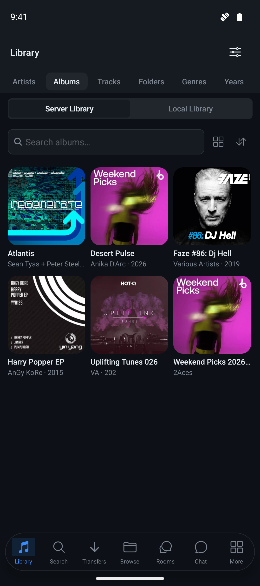
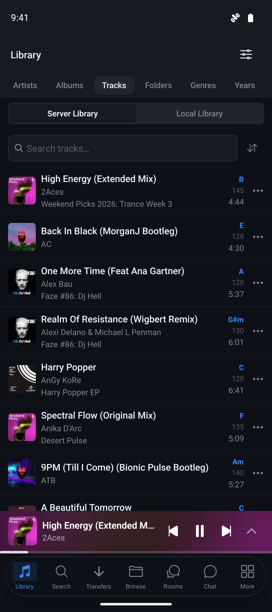
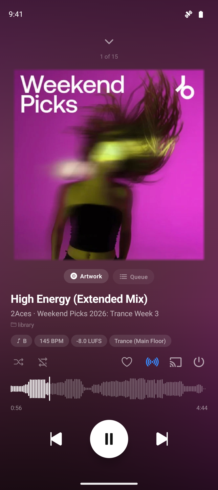
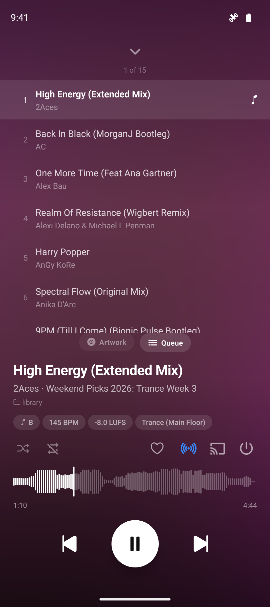
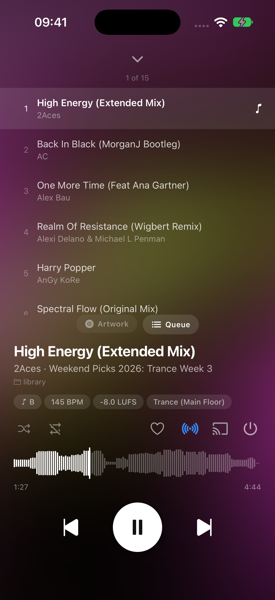
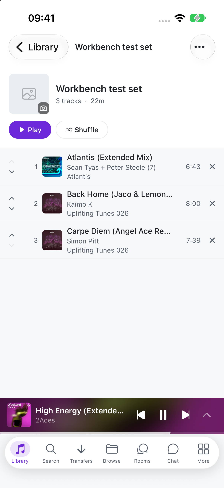
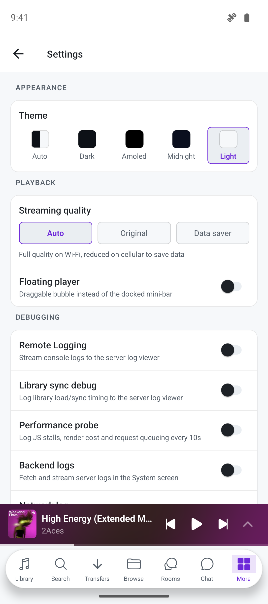

# Resonance mobile

The Android and iOS companion apps bring your Resonance library, playback, Soulseek transfers and community tools to a phone. They connect to a Resonance server; the desktop web workspace remains the home for the larger DJ preparation and rehearsal tools.

Updated **21 October 2026**. These features and screenshots describe the current development builds. Features and design can change, and more features are being added. Platform support depends on the native build, permissions and server configuration.

## Screenshots

Captured from the native apps connected to the isolated 15-track test library: Pixel 9 / Android 16 and iPhone 17 / iOS 27 simulators. These are native development-build captures, not phone-sized web pages. Select an image to view it at full resolution.

| Android | iOS |
| :---: | :---: |
|  |  |
| **Albums** — artwork tiles, search and library sources | **Albums** — native iOS navigation and artwork browsing |
|  |  |
| **Tracks** — analysed metadata and persistent playback controls | **Tracks** — the same server catalogue on iPhone |
|  |  |
| **Player** — artwork, waveform seeking and track information | **Player** — full-screen playback and casting control |
|  |  |
| **Queue** — switch between artwork and the running order | **Queue** — select the next track without leaving the player |
|  |  |
| **Mixtapes** — saved collections and ordering controls | **Mixtapes** — play, shuffle and edit a saved collection |
|  |  |
| **Preferences** — appearance and playback choices | **Preferences** — Light, Dark, AMOLED, Midnight or system appearance |

Capture dates, device details and scope are recorded in the [mobile screenshot guide](../docs/screenshots/mobile/README.md) and its manifest. This gallery verifies the displayed screens; it does not certify every feature or external device integration.

## Shared companion features

| Area | Current functionality |
| --- | --- |
| Connection | Enter a server address and sign in, or scan a short-lived pairing QR from the web app. Sessions use secure device storage. |
| Server library | Browse artists, albums, tracks, folders, genres and years. Search and sort within views; choose list or artwork tiles where available. |
| Track information | Show BPM, key, genre and loudness when the server has supplied them. Analysis status and library updates arrive through the server connection. |
| Playback | Mini-player and full-screen player, waveform seeking, queue selection, previous/next, shuffle, repeat and loved tracks. Native playback service handles background and remote controls. |
| Streaming | Automatic, Original and Data saver modes. Automatic prefers original quality on Wi-Fi and smaller streams on cellular; transcoding requires the server's media tools. |
| Mixtapes | Create, rename and delete mixtapes; add, remove and reorder tracks; play or shuffle a collection. Publishing and sharing use server permissions. |
| Casting | Google Cast controls for compatible receivers on a reachable network. This differs from the desktop web app's DLNA controls. |
| Soulseek | Search, filter results, browse shared folders and manage server transfers. The Resonance server maintains the Soulseek connection. |
| Community | Rooms, mentions, private conversations and unread indicators, with live updates. |
| Administration | Role-dependent overview, server status, connection, logs and relay controls. These entries are hidden from accounts without the required role. |
| Preferences | Light, Dark, AMOLED and Midnight themes, system appearance, mini-bar or experimental floating player, notification preferences and optional diagnostic logging. |
| Local cache | SQLite metadata and artwork caches speed up repeat browsing. Cached server metadata is not an offline download of the audio. |

## Platform differences

| Capability | Android | iOS |
| --- | --- | --- |
| Server library and player | Present in the current app | Present in the current app |
| On-device audio library | Local media scanning, tag/artwork caching and playback, subject to audio-library permission | Do not assume Android-equivalent access to arbitrary music files; local audio-library support still needs separate validation |
| Copy local tracks to a chosen folder or USB storage | Android Storage Access Framework picker; a writable, mounted destination is required | Currently unsupported |
| Android Auto | Native browse tree and playback integration are implemented; vehicle testing is separate | No CarPlay integration is provided by this implementation |
| Floating player | In-app bubble, plus an optional native overlay over other apps when permission is granted | In-app bubble; no Android-style overlay over other apps |
| In-app APK installation | Android package update flow, subject to OS installation permission | Not applicable; iOS uses Apple's signing and distribution mechanisms |
| Push delivery | Requires a configured native build, push service and notification permission | Requires a configured native build, push service and notification permission |

Copying audio files to a folder is separate from the desktop **Pioneer USB export**. It does not build a Rekordbox database, player analysis files or a Pioneer Network Link service. The desktop set planner, full-set rehearsal, detailed beat/phrase overlays and processing controls should not be read as mobile feature-parity claims.

## Build and connect

See the [Expo development guide](EXPO_GUIDE.md) for local Android/iOS builds and the current SDK requirements. This project includes native playback, casting and custom Android modules, so use a **development build**, not Expo Go.

Start your Resonance server, open the installed app and enter its address or use the pairing QR. On a real phone, `127.0.0.1` refers to the phone itself: use a server address reachable from that device. The desktop service must already have its library locations configured and indexed.

Android APK build workflows exist in the repository. The iOS project is configured for native builds, but a simulator screenshot is not an App Store or TestFlight release. Distribution status and downloadable builds can change independently of this source snapshot.

## Keeping this guide current

Update this page and [FEATURES.md](../FEATURES.md) when mobile behaviour changes. Recapture affected screens, retain the platform labels and record the new capture date. Describe implemented, configured and unverified capabilities separately; keep future additions out of the current feature table until they exist.
